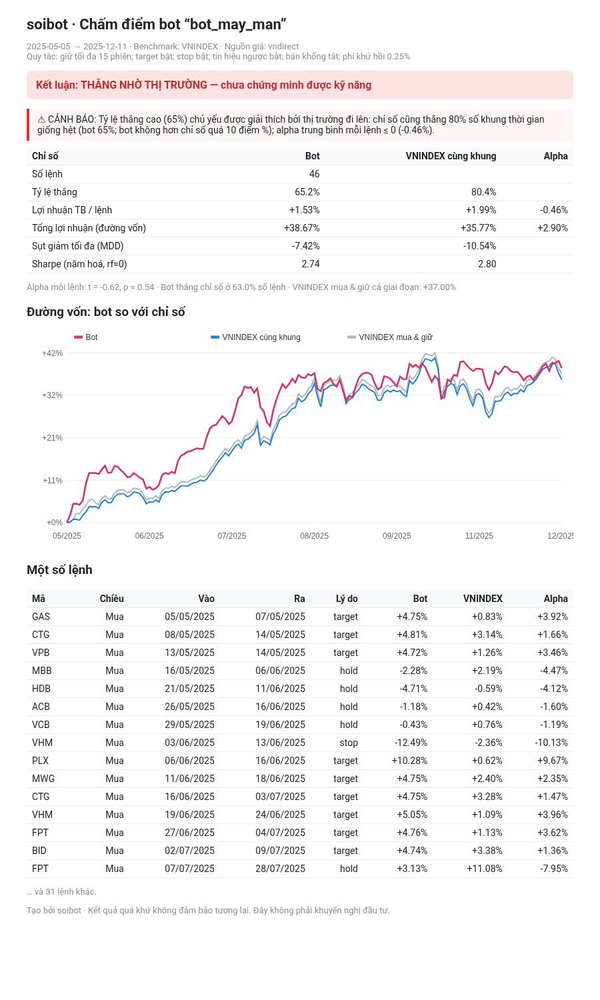

# soibot — Soi bot tín hiệu chứng khoán

> **Hook Reel:** “Bot báo thắng 65%? VN-Index nằm im cũng thắng 80%. Soi thử 20 giây là biết.”

`soibot` là công cụ dòng lệnh (Python) **chấm điểm bot/nhóm phát tín hiệu chứng khoán** bằng backtest
trên giá lịch sử thật, và quan trọng nhất: **so với VN-Index trong đúng những khung thời gian đó**.
Nếu tỷ lệ thắng cao chỉ vì thị trường đang lên, soibot sẽ cảnh báo rõ ràng.

⚠️ **Không phải khuyến nghị đầu tư.** Kết quả quá khứ không đảm bảo tương lai. Công cụ không hứa hẹn lợi nhuận.



## Cài đặt

```bash
git clone https://github.com/vietphan98/soibot && cd soibot
pip install -e .          # hoặc: pip install pandas numpy requests
```

## Demo 20–30 giây

```bash
python -m soibot samples/bot_may_man.csv --hold 15        # bot "may mắn nhờ sóng tăng" → hiện CẢNH BÁO
python -m soibot samples/bot_dong_luong.json --hold 20    # bot động lượng → alpha dương, nhưng chưa đủ ý nghĩa thống kê
# Không có mạng? Dùng dữ liệu mẫu offline:
python -m soibot samples/bot_may_man.csv --hold 15 --source offline
```

Mỗi lệnh in báo cáo ra terminal và tạo file `<tên>_report.html` (tự chứa, mở bằng trình duyệt,
có biểu đồ đường vốn bot so với chỉ số). Ảnh mẫu: `docs/bot_may_man.png`, `docs/bot_dong_luong.png`.

## Định dạng tín hiệu

CSV (cột `target`, `stop` không bắt buộc):

```csv
symbol,date,side,target,stop
FPT,2025-05-05,buy,125.5,108
HPG,2025-05-07,sell,,
```

JSON: một mảng như trên, hoặc `{"signals": [ ... ]}`. Giá target/stop theo **nghìn đồng, giá đã điều chỉnh**.

## Quy tắc thoát lệnh (tùy chỉnh được)

- Vào lệnh tại **giá đóng cửa** phiên có tín hiệu (ngày nghỉ → phiên kế tiếp).
- `buy` mở vị thế mua. `sell` đóng vị thế mua đang mở; thêm `--short` để `sell` mở vị thế bán khống.
- Mỗi phiên sau đó kiểm tra lần lượt: **cắt lỗ** → **chốt lời** → **tín hiệu ngược chiều** → **hết `--hold` phiên** (thoát giá đóng cửa).
  Cùng phiên chạm cả stop lẫn target: coi như chạm stop (bảo thủ). Mở cửa nhảy qua mức giá: khớp giá mở cửa.
- Mỗi mã chỉ một vị thế một lúc; lệnh còn mở cuối dữ liệu đóng ở giá cuối (`end`).
- Phí + thuế khứ hồi mặc định 0,25% (`--fee`). Tắt từng quy tắc: `--no-target`, `--no-stop`, `--no-opposite`.

## Nguồn dữ liệu

1. **VNDirect** (API công khai `api-finfo.vndirect.com.vn`, giá cổ phiếu đã điều chỉnh, chỉ số VNINDEX/VN30/HNXINDEX) — nguồn chính, đã chạy được.
2. **Yahoo Finance** (`<MÃ>.VN`) — dự phòng khi VNDirect lỗi; đã chạy được cho cổ phiếu, *không* có lịch sử VN-Index.
3. **Dữ liệu mẫu offline** trong `samples/offline_prices/` (VN-Index + 20 mã, 12/2024–01/2026) — **chỉ để demo**, ghi rõ “DỮ LIỆU MẪU OFFLINE” trong báo cáo.

Giá được cache ở `~/.cache/soibot` (đổi bằng biến `SOIBOT_CACHE`; bỏ cache: `--no-cache`).
API miễn phí có thể đổi hoặc ngừng bất cứ lúc nào.

## Các chỉ số

| Chỉ số | Ý nghĩa |
|---|---|
| Tỷ lệ thắng | % lệnh có lợi nhuận > 0 sau phí |
| Lợi nhuận TB / lệnh | trung bình % lãi/lỗ mỗi lệnh |
| Tổng lợi nhuận | đường vốn chia đều cho các lệnh đang mở mỗi phiên, nhân dồn |
| Sụt giảm tối đa (MDD) | mức giảm sâu nhất từ đỉnh của đường vốn |
| Sharpe | trung bình / độ lệch chuẩn lợi nhuận ngày × √252 (lãi suất phi rủi ro = 0) |
| **Chỉ số cùng khung** | giữ VN-Index (hoặc `--bench VN30`…) **đúng các ngày vào/ra** của từng lệnh |
| **Alpha** | lợi nhuận bot − lợi nhuận chỉ số cùng khung (mỗi lệnh và tổng), kèm t-stat, p-value |
| Tỷ lệ thắng của chỉ số | % khung thời gian mà chỉ số cũng tăng |

**Cảnh báo “thắng nhờ thị trường”** hiện khi tỷ lệ thắng ≥ 55% **và** ít nhất một điều sau: tỷ lệ thắng của chỉ số
không thấp hơn của bot quá 10 điểm %, alpha trung bình ≤ 0, hoặc alpha dương nhưng t < 2. Dưới 20 lệnh còn có cảnh báo mẫu nhỏ.

## Gửi tóm tắt Telegram (tuỳ chọn)

```bash
export TELEGRAM_BOT_TOKEN=... TELEGRAM_CHAT_ID=...
python -m soibot samples/bot_may_man.csv --telegram            # gửi thật
python -m soibot samples/bot_may_man.csv --telegram-dry-run    # chỉ in nội dung
```

## Kiểm thử

```bash
pip install pytest && python -m pytest -q
```

Mẫu `samples/` được sinh tất định bằng `scripts/make_samples.py` (bot may mắn: mua ngẫu nhiên mã VN30 trong sóng tăng 2025;
bot động lượng: mua mã mạnh nhất so với VN-Index, không nhìn trước tương lai).

## Tác giả & giấy phép

Tác giả: **Việt Phan**. Giấy phép MIT — xem [LICENSE](LICENSE). Thư viện bên thứ ba: [THIRD_PARTY_LICENSES.md](THIRD_PARTY_LICENSES.md).
